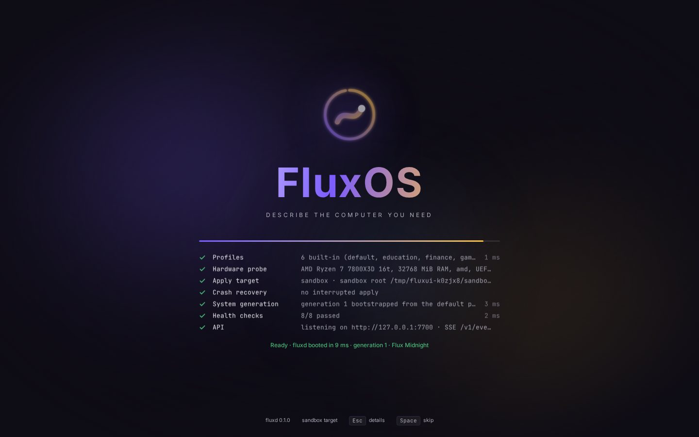
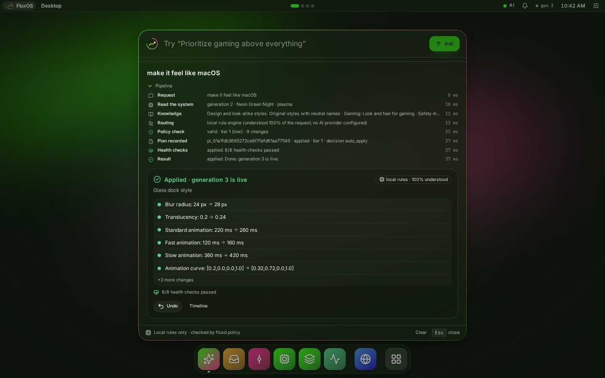
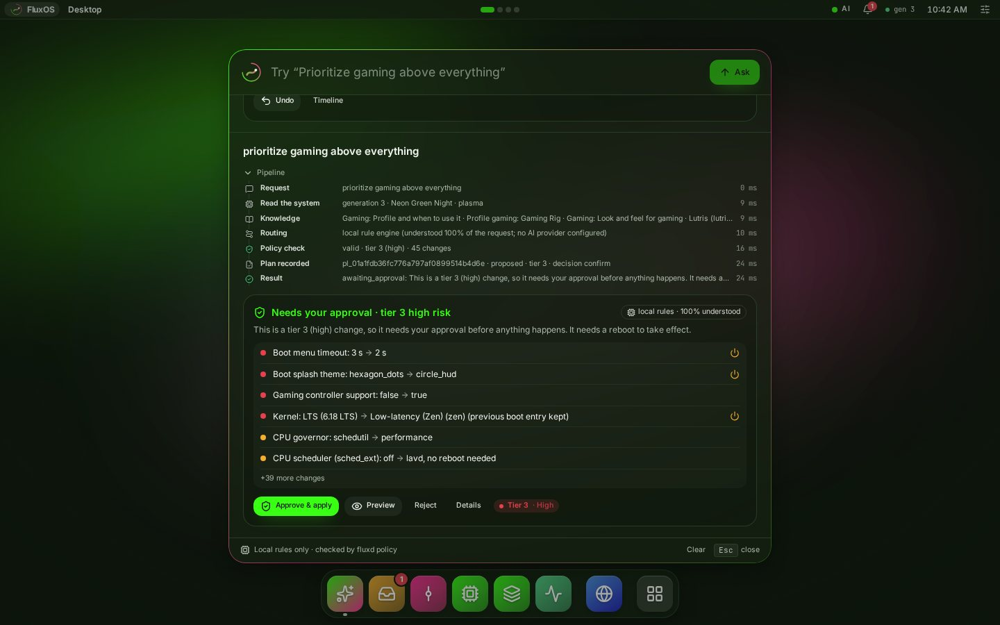
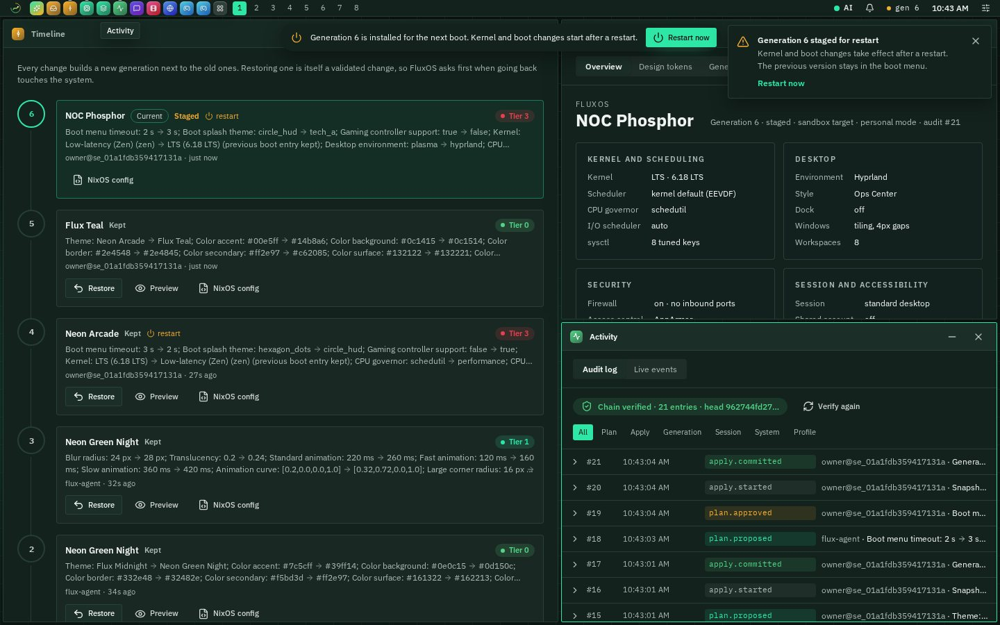
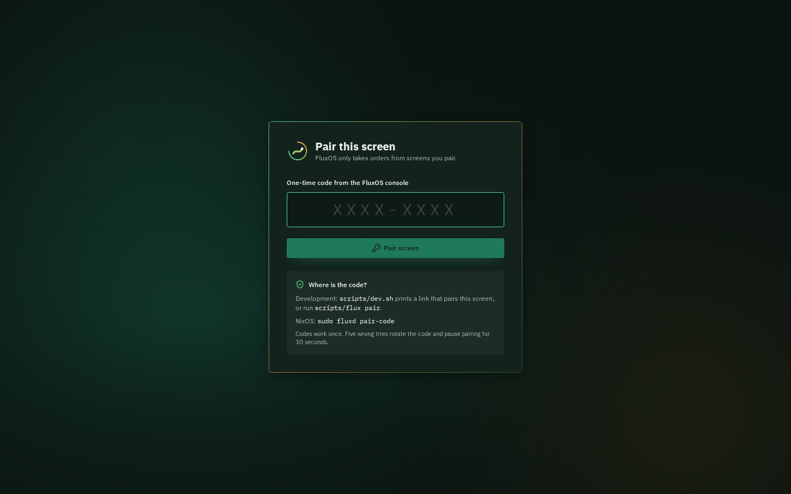

# FluxOS

Describe the computer you need, and get it.

FluxOS is an AI-driven operating system builder on NixOS. A person or a company describes what they need in plain language; an AI planner turns it into a typed plan; a privileged daemon validates the plan, snapshots the system, applies it, checks health, and commits or rolls back. The same engine produces a gaming rig, a classroom lab, a network operations desk, a trading desk or a clinical workstation from reusable profiles.

The rule the whole backend is built around: **the AI has wide reach, but every action is validated, reversible, and logged.**

> Working name: the PRD calls the product MorphOS, which collides with an existing OS. This repository uses FluxOS.

| Boot | Ask for a change | Approve a system change |
|---|---|---|
|  |  |  |

| Telecom operations desk (tiling) | Pairing a screen |
|---|---|
|  |  |

## What is in this repository

| Component | Language | Role |
|---|---|---|
| `crates/flux-core` | Rust | System schema, tool registry (default-deny), policy engine, diff and risk classification, design tokens (W3C DTCG 2025.10), contrast-safe palette generation, renderers (NixOS module, CSS, GTK, KDE, Hyprland, GNOME dconf, SVG wallpapers). Pure logic, no I/O. |
| `crates/fluxd` | Rust | The daemon and trust boundary. HTTP + SSE API, auth and roles, generations (snapshots), apply targets (sandbox, NixOS), health checks with automatic rollback, crash recovery at boot, hash-chained audit log, signed profile bundles, MCP endpoint. |
| `agent/` | TypeScript | The AI orchestrator ("AI in the middle"). Local rule engine fast path, multi-provider LLM failover (Anthropic, OpenAI-compatible, Ollama), retrieval over industry knowledge, clarifying questions, validate-and-repair loop, streaming pipeline events. Runs unprivileged. |
| `ui/` | TypeScript, React | The web shell, served by fluxd. A boot screen that replays fluxd's real boot stages, one-time-code pairing, and a desktop that follows the live system spec (theme tokens, dock, panel, tiling, workspaces). Apps: the assistant with its pipeline trace, approvals with previews, the generation timeline, system and design tokens, profiles, and the audit log. |
| `profiles/` | JSON | Industry profiles: default, gaming, education, telecom, finance (preview), healthcare (preview). |
| `nix/`, `flake.nix` | Nix | Packages, a NixOS module that runs both services and serves the UI, and a bootable demo VM. |
| `scripts/` | Bash | `dev.sh` boots the backend and the UI locally; `flux` is a small CLI for it; `verify/` reproduces the verification. |

## Architecture

```
  person / web UI / MCP client
            │  "set this up for a telecom operations desk"
            ▼
  ┌──────────────────────────── flux-agent (unprivileged) ───────────────────────────┐
  │ intake → retrieve (BM25 over knowledge, profiles, catalog)                        │
  │ route:  local rule engine ── confident? ──► plan                                  │
  │         └─ novel request ──► LLM chain: anthropic → openai → ollama (failover)    │
  │ clarify only when the answer changes the outcome                                  │
  │ validate with fluxd → repair loop with fluxd's error messages                     │
  └──────────────────────────────────────┬────────────────────────────────────────────┘
                 typed plan (agent token: propose + apply tier 0-1 only)
                                         ▼
  ┌──────────────────────────────── fluxd (privileged) ───────────────────────────────┐
  │ policy engine: registry lookup (default-deny) → typed params → simulate on a copy │
  │   → validate spec (catalogs, ranges, contrast, hardware) → diff → tier per change │
  │ decision: tier 0-1 auto-apply │ tier 2-3 human approval bound to plan hash │ 4 never│
  │ apply: render generation N → snapshot (N-1 kept) → target → health → commit/rollback│
  │ targets: sandbox (files + simulated boot entries) │ nixos (nixos-rebuild)          │
  │ audit: append-only, SHA-256 hash chain, journald │ events: SSE with replay buffer │
  └────────────────────────────────────────────────────────────────────────────────────┘
```

Why two processes: the model's output is never trusted. The agent can be wrong, confused or prompt-injected, and it still cannot approve a tier 2+ change, run a command, or reach a tool outside the registry, because those checks live in fluxd.

The web UI is a third client with no special powers. A browser pairs with a one-time code that fluxd prints to its log, and receives a revocable session token for one person; it never holds a static token. Approvals from the UI carry the hash of the plan the person reviewed, and fluxd checks the role and the hash again.

| Document | Contents |
|---|---|
| [docs/prd.md](docs/prd.md) | The product requirements and tech stack this repository implements |
| [docs/status.md](docs/status.md) | Current checkpoint: what is built, decisions, verification, next steps, open questions |
| [docs/architecture.md](docs/architecture.md) | How a request becomes a running system, where each guarantee is enforced, and how the web UI fits in |
| [docs/api.md](docs/api.md) | fluxd and flux-agent endpoints, events and payloads |

## Quick start

Requirements: Rust 1.88+, Node.js 22+, `jq` and `curl` for the CLI. Works on any Linux host; the default sandbox target never touches the host system.

```bash
scripts/dev.sh                       # builds and boots fluxd, flux-agent and the web UI (Vite, hot reload)
FLUX_UI=dist scripts/dev.sh          # or: build the UI once and let fluxd serve it on :7700
FLUX_UI=none scripts/dev.sh          # or: backend only
```

`dev.sh` prints a link such as `http://127.0.0.1:5173/#pair=K7QM3XRA`. Opening it pairs the browser as the device owner; the code works once. Run `scripts/flux pair` for the current code when you want to pair another screen. Press `Ctrl+K` on the desktop to ask for a change; `Esc` on the boot screen shows the stage details.

To use the CLI instead, in another terminal:

```bash
scripts/flux boot                                   # boot stages
scripts/flux say "make it feel like macOS with a teal accent"   # tier 0-1: applied with a snapshot
scripts/flux say "prioritize gaming above everything"           # tier 3: waits for approval
scripts/flux pending
scripts/flux approve <plan-id>                      # staged; kernel change needs a reboot
scripts/flux reboot                                 # simulated on the sandbox target
scripts/flux say "turn off the firewall"            # refused and audited
scripts/flux undo
scripts/flux audit
scripts/flux verify                                 # audit hash chain
```

The live, materialized system is under `.flux-state/sandbox/root` (the NixOS module, theme files, wallpaper), with one directory per generation under `.flux-state/generations/`.

### AI providers

Without keys, the local rule engine handles common requests (styles, colors, profiles, apps, services, ports, kernel and scheduler, accessibility, lock-down, undo, blocked actions). For open-ended requests, copy `agent/.env.example` to `agent/.env` and set any of:

| Variable | Default model |
|---|---|
| `ANTHROPIC_API_KEY` | `claude-sonnet-5-5` (`FLUX_ANTHROPIC_MODEL`) |
| `OPENAI_API_KEY` (+ `OPENAI_BASE_URL` for compatible servers) | `gpt-6.2-sol` (`FLUX_OPENAI_MODEL`) |
| `OLLAMA_HOST` | `qwen3:8b` (`FLUX_OLLAMA_MODEL`), local and private |

Providers are tried in `FLUX_AI_PROVIDERS` order with a circuit breaker. `FLUX_AI_ROUTING=local` keeps every request on the device.

## Safety model

| Tier | Examples | What fluxd does |
|---|---|---|
| 0 Safe | palette, fonts, motion, wallpaper, dock layout, accessibility | applies with a snapshot |
| 1 Low | user apps (Flathub), window behavior, style presets, hostname | applies, undo offered |
| 2 Medium | system packages, services, firewall ports, sysctl, governor, sched_ext, desktop switch | needs the owner (fleet mode: an administrator) |
| 3 High | kernel switch, drivers, security policy, kiosk/exam, boot, whole profiles | needs approval, sandbox build first, previous boot entry kept |
| 4 Blocked | shell commands, disk wipe/format, disabling the firewall or audit, deleting audit logs | never |

The tier of a plan is the maximum of the declared tool tiers and the tiers of the concrete changes it causes, so a "safe" tool cannot smuggle a risky change. Approvals are bound to a plan hash, permissions are checked again at apply time, and plans are re-validated against the live state before activation.

Browsers get the same scrutiny. Pairing codes are single use, and five wrong tries rotate the code and pause pairing for 30 seconds. fluxd answers only to loopback Host names (HTTP 421 otherwise, which stops DNS rebinding), serves the UI with a strict Content-Security-Policy, and sandboxes rendered artifacts it shows in the UI. Theme names, which reach CSS and SVG output, are limited to letters, digits and simple punctuation.

Operators can add change-freeze windows and disable tools in `<state>/policy.json`:

```json
{ "mode": "fleet",
  "freeze_windows": [{ "name": "trading-hours", "days": [1,2,3,4,5], "start": "09:30", "end": "16:00", "utc_offset_minutes": -300, "min_tier": 2 }],
  "disabled_tools": ["desktop.set_environment"] }
```

## Bootable FluxOS (NixOS)

- `nix run .#vm` builds and boots a QEMU machine with fluxd and flux-agent as systemd services, Plasma, and the Flux Midnight theme from `nix/hosts/fluxos/generated.nix` (generation 1). On first boot the flake is copied to `/etc/nixos`, and fluxd applies later generations with `nixos-rebuild --flake path:/etc/nixos#fluxos-vm`. Login `flux` / `flux`. The FluxOS UI opens after login and is already paired, because the demo user logs in automatically and is an administrator anyway.
- On an existing NixOS machine, import `nix/module.nix` and `/etc/nixos/fluxos/generated.nix`, set `services.fluxos.enable = true`, and rebuild. Open "FluxOS" from the app launcher (or `http://127.0.0.1:7700/`) and pair it with the code from `sudo fluxd pair-code`. `services.fluxos.ui.enable = false` turns the UI off.

The NixOS target builds every generation (`nixos-rebuild build`) before activating it, uses `nixos-rebuild boot` for kernel and boot changes so the running system is untouched until reboot, and restores the previous configuration if anything fails.

## Verification

The checks behind the claims above live in `scripts/verify/` and all pass at the current checkpoint:

```bash
cargo build -p fluxd && (cd agent && npm ci && npm run build)
scripts/verify/daemon.sh     # 104 checks: tiers, approvals, blocked actions, rollback, recovery, audit, fleet mode, pairing, Host guard, UI serving
scripts/verify/agent.sh      # 33 checks: local engine, LLM failover and repair loop (scripted mock), prompt injection
scripts/verify/nix-eval.sh   # 29 checks: every profile, the packages and the bootable VM evaluate against nixpkgs 26.05 (needs nix)
(cd ui && npm ci && npm run build)   # type-checks and builds the web UI
```

Not verified yet: booting the VM image, `nixos-rebuild` on a real NixOS host, Nix builds of the packages, and calls to real Anthropic, OpenAI or Ollama endpoints. See [docs/status.md](docs/status.md) for the full checkpoint: decisions, gaps, next steps and open questions.

## Repository layout

```
crates/flux-core/src/   spec, registry, ops, policy, diff, catalog, tokens, color, profiles, render/
crates/fluxd/src/       main, boot, engine, api, mcp, store, audit, auth, signing, health, hwprobe, targets/
agent/src/              main, pipeline, heuristic, prompt, retrieval, context, fluxd client, providers/
agent/knowledge/        industry and design knowledge for retrieval
ui/src/                 boot/, pair/, desktop/ (shell, dock, panel, windows), assistant/, apps/, state/, lib/
profiles/               industry profile overlays
nix/                    packages, NixOS module, VM host and its generation-1 module
scripts/verify/         end-to-end verification (daemon, agent, Nix evaluation)
docs/                   PRD, status, architecture, API reference and screenshots
```

## License

MIT, see [LICENSE](LICENSE).
